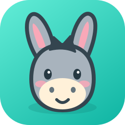

# Donqui Studio

OpenScreen을 기반으로 만든 음악·나레이션 중심의 사진·영상 편집 데스크톱 프로젝트입니다. 당나귀 마스코트, 차콜/청록 색상과 한국어 시작 화면을 사용합니다.



## 실행

의존성(`npm ci`)과 Windows 네이티브 구성요소를 준비한 뒤 이 폴더의 `start-donqui.cmd`를 더블클릭합니다. 소스가 마지막 빌드보다 새로우면 먼저 `npm run build-vite`로 다시 빌드하고 실행하므로, 코드를 고친 뒤에도 따로 빌드하지 않아도 됩니다. 기존 `start-mangopang.cmd` 바로가기도 새 실행기로 연결됩니다. 네이티브 구성요소의 준비 방법은 [AGENTS.md](AGENTS.md)를 확인하세요.

개발 모드는 Node 22.22.1 / npm 10.9.4에서 `npm run dev`로 시작합니다.

## 사용 순서

탭은 **Audio → V.Clip → 미디어 → 편집 → 녹화** 순서입니다.

1. 상단 **새 프로젝트**로 이름을 정한 뒤 **Audio** 탭에 음악이나 나레이션을 먼저 추가할 수 있습니다. 오디오 없이 사진·영상만으로 시작해도 됩니다.
2. **V.Clip** 탭에서 **영상 가져오기**로 촬영 원본을 여러 개 한꺼번에 추가합니다. AutoVeo의 영상 클립 화면처럼 모든 영상이 한 화면에 영상별로 나오고, 여러 영상의 구간을 함께 다룹니다.
3. **클립 길이**(2~20초, 기본 5초)를 정하고 **모든 영상 구간 찾기**를 누르면 영상을 하나씩 차례로 분석합니다. 영상마다 전체에 고르게 퍼진 구간 최대 12개를 이 컴퓨터의 Ollama 비전 모델(예: `qwen3-vl:4b`)이 보고 점수·장면 종류·설명·자막 초안을 붙이며, 40% 넘게 겹치는 구간은 점수가 낮은 쪽을 빼고 가장 좋은 3개를 먼저 선택합니다. 영상별 **구간 찾기**로 하나만 분석할 수도 있습니다.
4. 분석 모델은 **AI 설정 → 로컬 비전 모델 (Ollama)**에서 고릅니다(V.Clip 상단의 **AI 설정** 버튼으로도 열림). 기본은 설치된 가장 가벼운 비전 모델이고, Ollama가 없거나 **AI 없이 (화질 점수만)**을 고르면 선명도·밝기·흔들림·움직임으로 점수를 매깁니다.
5. 카드의 **미리보기**는 원본에서 그 구간만 반복 재생합니다. 재생 중 **여기를 시작으로**·**여기를 끝으로**로 경계를 잡거나, 시작·끝·길이를 입력하거나 −/+로 0.5초씩 밉니다. **구간 직접 추가**는 마지막 구간 뒤에 클립 길이만큼 새 구간을 만들고, **모든 구간에 적용**은 모든 구간을 시작 위치는 두고 클립 길이로 맞춥니다.
6. **넣기/빼기**로 고릅니다. Audio를 넣었다면 **남은 Audio만큼 선택**이 여러 영상에 걸쳐 좋은 구간부터 남은 길이를 채울 만큼 고릅니다. **선택한 구간 N개 클립으로 나누기**는 원본의 시작·끝만 기록하므로 곧바로 끝나고, 나눈 클립은 미디어 탭의 **V.Clip 클립** 목록에 모입니다. 나눈 뒤 구간을 고치면 **바뀜 · 다시 나누기**로 표시되고, 다시 나누면 같은 클립이 갱신됩니다. 분석은 다른 탭으로 옮겨도 계속됩니다.
7. **미디어** 탭 왼쪽 **소재**에는 V.Clip 클립·사진·영상이 있고, **조합에 넣기**(또는 **모두 조합에 넣기**)로 오른쪽 **조합**에 순서대로 넣습니다. **사진 추가**는 여러 장을 한 번에 가져오며 원본 파일 그대로 두고 **사진 길이**(기본 5초)로 조합에 들어갑니다. 영상 카드에서는 **전체 넣기**, **V.Clip에서 나누기**, 대본 보기, 효과 없이 타임라인에 바로 추가를 할 수 있습니다.
8. **조합**에서 항목마다 길이와 **Remotion 효과**를 정합니다. 줌 인·줌 아웃·상하좌우 이동·페이드·슬라이드·떠오르기·시네마틱 틸트 중 고르거나 **효과 없음**, **랜덤 적용**을 고르고, ▶로 효과가 적용된 모습을 바로 봅니다. **새 항목 효과**는 앞으로 넣을 항목의 기본값이며 **모든 항목에 적용**으로 한꺼번에 바꿉니다. 랜덤은 항목마다 따로 정해지고 **랜덤 다시 섞기** 전까지 미리보기와 결과가 같습니다. ↑·↓로 순서를 바꿉니다.
9. Audio에 음악이나 나레이션이 있으면 **Audio 길이에 맞추기**가 모든 항목을 길이 비율대로 늘이거나 줄여 조합이 Audio와 함께 끝나게 합니다. 사진은 원하는 만큼, 클립·영상은 원본 안에서만 늘어나며(끝을 먼저, 끝에 닿으면 시작을 앞으로) 모자라거나 넘치면 알려 줍니다. 같은 영상에서 나눈 클립끼리는 서로 보여 주지 않는 장면으로만 늘어나 같은 장면이 두 번 나오지 않고(사이 구간은 반씩 나눔), 그것으로 모자랄 때만 이웃 클립의 장면까지 늘어나며 그렇다고 알려 줍니다. 나레이션의 받아쓰기가 끝났으면 **나레이션이 쉬는 곳에 컷 맞추기**가 항목 사이 컷을 1초 안의 말이 끊기는 자리로 옮깁니다.
10. **타임라인에 적용**은 효과가 있는 항목과 사진을 렌더링한 뒤 조합 순서대로 타임라인을 채웁니다. 타임라인에 클립이 있으면 확인한 뒤 바꾸며, Audio는 그대로이고 실행 취소할 수 있습니다. 효과 없는 클립은 원본에서 바로 재생하므로 렌더링하지 않습니다. **타임라인 끝에 추가**는 기존 클립 뒤에 붙입니다. 렌더링은 다른 탭으로 옮겨도 계속되고 **멈추기**로 중단할 수 있습니다.
11. 기존 클립은 **편집 → 클립 편집**에서 추가로 자르거나 이동·복제·삭제할 수 있습니다. **직접 자막 추가**에서는 수동 자막을 별도로 저장합니다.
12. **내보내기**에서 MP4를 선택합니다. 사진과 영상, 오디오, 수동 자막이 함께 출력됩니다.

## 저장과 안정성

- 원본 사진·영상은 수정하지 않습니다. 사진은 타임라인에 적용할 때 앱 데이터 폴더의 `media/image-clips`(효과 없음) 또는 `media/clip-effects`(효과)에 파생 MP4를 만듭니다. 이 폴더의 파일도 프로젝트에 필요한 미디어이므로 임의로 삭제하지 마세요.
- V.Clip에서 나눈 클립과 미디어의 사진·조합은 프로젝트 파일(`mediaBoard`)에 저장됩니다. 클립은 원본의 시작·끝만 기록하고, 조합 항목은 그 구간을 복사해 가지므로 길이를 맞춰도 V.Clip 클립은 그대로입니다. 영상을 프로젝트에서 지우면 그 영상의 클립과 조합 항목도 함께 지워집니다.
- 분석 모델, V.Clip 클립 길이, 미디어의 새 항목 효과와 사진 길이는 이 컴퓨터의 설정으로 기억합니다. 카드 썸네일은 FFmpeg로 뽑아 `media/vclip-thumbnails`에 캐시합니다.
- 사진 변환은 한 번에 하나씩, FFmpeg CPU 스레드 2개로 처리합니다. 제한은 60분이며 내용 해시+변환 버전+길이로 결과를 재사용합니다. 임시 파일은 성공한 경우에만 완성 파일로 바뀝니다.
- Audio 탭으로 가져온 음악·나레이션은 영상 편집과 독립된 시간에 고정됩니다. 영상 클립을 줄이거나 재배치해도 음원 길이는 보존됩니다. 최종 영상 길이는 배치한 영상 클립으로 정해지므로 Audio 길이까지 화면을 채워 주세요.
- Remotion 클립은 앱 데이터의 `media/clip-effects`에 보관하며 원본 내용·효과·구간·버전으로 캐시합니다. 첫 생성에는 렌더 시간이 필요합니다. 효과 출력은 최대 1080p(세로형 포함), 30fps입니다.
- V.Clip 분석 결과는 앱 데이터의 `media/vclip-analysis`에 파일(경로·크기·수정 시각)·구간·모델별로 캐시하므로 같은 영상을 다시 분석하면 바로 끝납니다. 프레임은 FFmpeg가 키프레임만 디코딩해 뽑고(4K HEVC 드론 영상 포함), 루프백 주소의 Ollama에만 보냅니다. `OLLAMA_HOST`가 다른 컴퓨터를 가리켜도 영상 프레임은 이 컴퓨터를 떠나지 않습니다.
- 측정값(이 PC, `qwen3-vl:4b`): 4K HEVC 2분 47초 드론 영상 12개 구간 분석 약 1분, 5초 효과 클립 하나 렌더 약 75초.
- 효과 렌더링에는 설치된 Chrome 또는 Edge가 필요합니다. 별도 위치의 브라우저는 `DONQUI_CHROME_PATH`로 지정할 수 있으며 렌더 중 자동 다운로드는 하지 않습니다. `npm run build-vite`와 `npm run dev`가 전용 효과 번들을 준비합니다.
- 이름을 바꿔도 기존 프로젝트·설정·사진 파생 클립을 계속 찾도록 OS 앱 데이터 폴더 아래 `MangopangStudio` 경로를 유지합니다. 원본 OpenScreen 및 AutoVeo와 분리됩니다. 개발용 분리 프로필은 `DONQUI_USER_DATA`로 지정하며, 기존 `MANGOPANG_USER_DATA`도 지원합니다.
- 테마는 기존 `mangopang-theme` 값을 읽어 `donqui-theme`에 보존합니다. `.openscreen` 프로젝트 파일 형식은 그대로 사용합니다.
- OpenScreen 업데이트로 이 프로젝트가 덮어써지지 않도록 원본 자동 업데이트 채널을 비활성화했습니다.
- Windows/macOS/Linux용 당나귀 아이콘과 패키징 설정을 포함합니다. 설치 프로그램과 각 운영체제의 네이티브 기능은 별도 빌드·검증이 필요합니다.

## 개발/검증

```text
npm ci
npm run build-vite
npx tsc --noEmit
npx tsc -p tsconfig.test.json --noEmit
npm run lint
npm run test -- --maxWorkers=2
npm run i18n:check
npm run docs:check
```

외부 미디어 검증은 PowerShell에서 아래 순서로 실행합니다.

```powershell
$env:MANGOPANG_INTEGRATION = '1'
npx vitest run electron/media/imageClip.test.ts src/lib/ai-edition/document/manualSubtitle.test.ts --maxWorkers=2
Remove-Item Env:MANGOPANG_INTEGRATION
$env:DONQUI_VCLIP_INTEGRATION = '1'
npx vitest run electron/media/vclipAnalysis.test.ts
Remove-Item Env:DONQUI_VCLIP_INTEGRATION
node scripts/donqui-smoke.cjs
node scripts/vclip-smoke.cjs "C:\경로\촬영영상1.MP4" "C:\경로\촬영영상2.MP4" --photo="C:\경로\사진.jpg"
```

`vclip-smoke.cjs`는 20초 음악을 넣은 새 프로젝트에 주어진 영상 여러 개를 한꺼번에 가져와 V.Clip으로 분석하고(AI 설정의 Ollama 모델 사용, `--no-ai`면 화질 점수만), 구간 하나를 미리 보며 끝을 잡고 다른 하나를 0.5초 민 뒤 음악을 채울 구간을 클립으로 나눕니다. 이어 미디어에서 랜덤 효과로 조합하고(`--photo=<사진>`을 주면 사진도 넣음) 음악 길이에 맞춰 타임라인에 적용한 뒤 저장된 프로젝트를 확인합니다. `donqui-smoke.cjs`는 합성 소스로 오디오 먼저 → V.Clip 직접 자르기·나누기 → 사진(랜덤 효과)과 클립(줌 인) 조합·맞추기·적용 → MP4 내보내기 → 재시작 후 다시 적용까지 확인합니다.

검증 산출물과 로그는 `.local/`에 저장합니다. 자동 UI 검증은 별도 프로필을 사용하며, 파일 선택 대화상자만 테스트 파일로 대체합니다. 실제 OS 대화상자·녹화·웹캠·트레이를 검증한 것으로 간주하지 않습니다.

이번 변경의 검증 범위와 결과는 [DONQUI-VALIDATION.md](DONQUI-VALIDATION.md)를 확인하세요.

현재는 개발 실행본입니다. 설치 프로그램은 아직 제작하지 않았습니다. 네이티브 소스 변경/설치 패키지 제작에는 upstream의 Windows C++/Rust 빌드 절차와 검증이 필요합니다.

## 기반과 다음 범위

- 기반: OpenScreen 소스와 기존 Mangopang Studio의 사진·영상·수동 자막 편집 기능입니다.
- 네이티브 파일은 소스와 맞는 전체 묶음을 준비해야 합니다. `npm run dev`와 `npm run build-vite`는 네이티브 파일을 컴파일하지 않습니다.
- AutoVeo의 AI 장면 추천, 그룹 자동 구성, 음성 생성 등 전체 기능 통합은 별도 개발 범위입니다.
- 원본 안내는 [README.openscreen.md](README.openscreen.md), 저작권/라이선스는 [LICENSE](LICENSE), 외부 구성요소 고지는 [THIRD-PARTY-NOTICES.md](THIRD-PARTY-NOTICES.md)를 확인하세요.

## 아이콘 편집

원본은 `public/donqui.svg`입니다. `scripts/generate-donqui-icons.cjs`는 sharp로 PNG·ICO·ICNS와 렌더러 로고를 생성하고, `npm run assets:appx`는 Windows 타일을 생성합니다. sharp를 별도 설치한 경우 `DONQUI_SHARP_MODULE`에 모듈 경로를 지정할 수 있습니다. 기존 OpenScreen 아이콘과 저작권 고지는 보존합니다.
